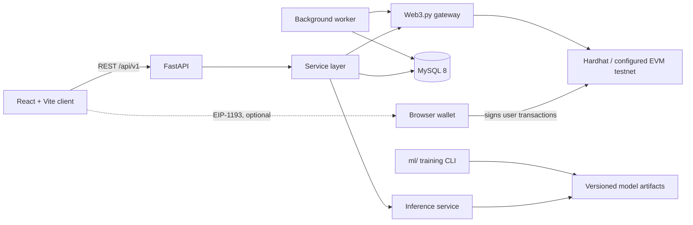

# PropTwin AI architecture

PropTwin AI is a modular monolith: one FastAPI service, one React client, one MySQL database, one Solidity contract, and an offline ML training pipeline. A monolith is deliberate. Nothing in the requirements needs independent service scaling, and a single transactional database makes the audit guarantees simpler to uphold.

## System context

## Layering rules

| Layer | Location | May depend on | Must not |
|---|---|---|---|
| Routers | `backend/app/api` | services, schemas, auth dependencies | contain business rules or raw queries |
| Services | `backend/app/services` | repositories, gateways, models | know about HTTP request objects |
| Gateways | `backend/app/ml`, `backend/app/blockchain` | torch / web3 | touch the database |
| Models | `backend/app/models` | SQLAlchemy | import services |
| Worker | `backend/app/workers` | services | duplicate business logic |

Authorization has two levels, both server-side: role checks through a `require_roles(...)` dependency, and object checks in `services/access.py`. Objects a caller may not read return 404, so that IDs cannot be probed.

## The four kinds of claim

The product must never blur these, so each has its own table, its own API field, and its own badge in the UI.

| Kind | Source | Meaning | Does not mean |
|---|---|---|---|
| AI estimate | `valuations` | A model's estimate from the listed inputs | A sale price or certified appraisal |
| Hypothetical simulation | `simulation_runs` | The stated formula applied to the stated assumptions | A forecast |
| Verified document | `property_verification_requests` | A named verifier reviewed the files and recorded a decision | Legal title |
| Blockchain-confirmed event | `blockchain_transactions`, `blockchain_events` | A transaction reached the confirmation policy | Legal ownership or truth of the data |

## Key design decisions

### Authentication

Argon2id hashes. 15-minute JWT access token, held in memory by the client. The refresh token is 256 random bits, stored only as a SHA-256 hash, sent as an `HttpOnly`, `SameSite=Strict` cookie scoped to `/api/v1/auth`, and rotated on every use. Reuse of a rotated token after a 10-second grace window revokes the whole token family; the window lets two tabs refresh together without ending the session. The client waits for the session to be restored before any page loads its data, and only a 401 ends a session, never a rate limit or network failure. Because the only cookie is the refresh cookie, CSRF exposure is limited to the auth routes, which also require an `X-Requested-With` header.

Self-registration can choose only `owner` or `investor`. `verifier` and `admin` are granted only by an admin; the first admin is created by a CLI script that requires shell access.

### Machine learning

Training is an offline CLI that writes an immutable directory `ml/artifacts/<version>/` with the model, the fitted preprocessor, metrics and a manifest of SHA-256 digests. The API never trains.

- **Split:** temporal when transaction dates exist (train on oldest, validate, test on newest), since a random split would leak future market state.
- **Target:** log price, reported back in currency units. Metrics are computed in currency units on the held-out test set.
- **Baselines:** a median-per-locality rule and Ridge regression. The MLP is only eligible for promotion if it beats the best baseline on held-out data.
- **Uncertainty:** split conformal interval from validation residuals. It carries a stated coverage target, and its empirical coverage on the test set is stored in the metrics rather than assumed.
- **Valuation factors:** local sensitivity (the change in prediction when one feature is moved to a reference value). Reported as model sensitivity, never as market causation.
- **Promotion:** `candidate` to `approved` to `active`, by an admin. No active model means a `503 model_unavailable` response; there is no silent fallback.

### Digital twin

This is a **software-based digital twin driven by periodic updates and simulated events**. There are no sensor feeds and the product does not claim real-time synchronization. Snapshots are append-only. Every simulation records `method`: `formula` for transparent arithmetic on the baseline, or `model_rerun` when the model was actually rerun on changed inputs (for example a renovated condition). Scenarios never modify the property or twin state.

### Blockchain

**On-chain:** `keccak256` property key, record hash, record version, controller address, events. **Off-chain:** everything else.

- **Record hash:** `keccak256(salt || canonical_json)`, where canonical JSON has sorted keys, normalized values and a `hash_version`. The per-record 32-byte salt stays off-chain. Without it, an attacker could confirm a guessed address by hashing candidates (a dictionary attack). Consequence: verifying requires the application's stored salt, so third parties can verify only if a salt is disclosed to them.
- **Two signing paths:**
  1. *Relayer:* the backend signs with a key from the environment. It holds `REGISTRAR_ROLE` and is the default for registering and updating records.
  2. *Wallet:* the backend returns unsigned call data, the user's browser wallet signs, and the client returns the hash. Ownership-transfer proposal, acceptance and on-chain cancellation use this path, since the contract checks `msg.sender`.
- **Submitted hashes are not trusted.** The backend reads the transaction from the chain and checks sender, target contract and call data against what it prepared.
- **Status** moves `pending`, `submitted`, then `confirmed`, `failed` or `reverted`. `confirmed` is set only from a receipt with `status=1` and the configured number of confirmations.
- **Wallet is not ownership.** The contract tracks a controlling address, nothing more. The UI says so wherever a controller is displayed.

### Background work

A `background_jobs` table polled by a worker thread, using `SELECT ... FOR UPDATE SKIP LOCKED`, exponential backoff and a maximum attempt count. It handles transaction reconciliation, twin revaluation, and daily retention purges. Redis and Celery were left out because the load does not justify them.

### Money

`DECIMAL(18,2)` in MySQL, `Decimal` in Python, strings in JSON. The model's float output is converted to `Decimal` once, at the inference boundary, and rounded to whole currency units.

## Configuration

All configuration comes from environment variables, documented in `.env.example`. In production the app refuses to start with placeholder secrets, and refuses a known Hardhat development key.

## Scope limits

- Synthetic data is the default. Metrics measured on it show the pipeline works, not that it can value real property.
- File storage is local disk behind an interface. A cloud object store needs credentials and an adapter.
- Email is sent only when SMTP is configured. Otherwise the tokens are created and the delivery is reported as not configured.
