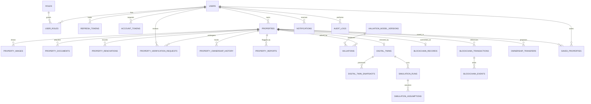

# Database schema

MySQL 8, InnoDB, `utf8mb4`, SQLAlchemy 2, Alembic. UUID primary keys for addressable entities. All timestamps UTC. Money is `DECIMAL(18,2)`, never float.

## ER diagram

`market_observations` is keyed by locality rather than by property, and `background_jobs` stands alone, so neither appears above.

## Tables

| Table | Purpose | Notable constraints |
|---|---|---|
| `users` | Accounts, optional verified wallet address | Unique lowercased email; unique wallet address |
| `roles`, `user_roles` | RBAC: `owner`, `investor`, `verifier`, `admin` | Composite PK |
| `refresh_tokens` | Refresh sessions | Unique `token_hash`; `family_id` for reuse revocation |
| `account_tokens` | Email verification and password reset | Unique `token_hash`; single use; expiry |
| `properties` | The actual property record | Checks on area, counts, price; indexes on owner, city/type/status, price |
| `property_images`, `property_documents` | Stored files and metadata | SHA-256 digest; server-generated storage keys |
| `property_renovations` | Renovation history | Non-negative cost |
| `property_verification_requests` | Verification workflow and decisions | Decision columns set once; at most one open request per property, enforced in a transaction |
| `property_ownership_history` | Application record of ownership | Effective-dated; source noted; not a legal title record |
| `property_reports` | Reported listings | Status workflow |
| `valuation_model_versions` | Model registry and metrics | Unique `version`; at most one `active`, enforced in a transaction |
| `valuations` | Immutable AI estimates | FK to model version (`RESTRICT`); `property_id` nullable for ad-hoc requests |
| `digital_twins` | Current twin state | Unique `property_id` |
| `digital_twin_snapshots` | Append-only history | Unique `(twin_id, version)` |
| `simulation_runs`, `simulation_assumptions` | Scenario results and typed inputs | `method` check: `formula` or `model_rerun` |
| `market_observations` | Locality index and rent observations | Unique `(locality, period, source)`; `is_synthetic` flag |
| `blockchain_records` | Latest commitment for a property | Unique `property_id`; unique `property_key`; salt stored here |
| `blockchain_transactions` | Transaction lifecycle | Unique `(network, tx_hash)`; status check |
| `blockchain_events` | Decoded contract events | Unique `(tx_id, log_index)` |
| `ownership_transfers` | Proposal and acceptance workflow | Status check |
| `saved_properties` | Favorites | Composite PK |
| `notifications` | In-app notifications | Index on `(user_id, read_at)` |
| `audit_logs` | Append-only actions | Indexed by entity and by time |
| `background_jobs` | Retryable work | Index on `(status, run_after)` |

## Relationships and deletion

History is never cascaded away. Properties, valuations, snapshots and chain rows use `ON DELETE RESTRICT`; deleting a property means archiving it. Only user-owned ephemera cascade with the user: refresh tokens, account tokens, favorites, notifications, and role links.

Multi-row operations, such as a property update that also writes a twin snapshot and an audit row, run in a single database transaction.

## Retention

| Data | Default policy |
|---|---|
| Audit logs | Keep 2 years (`AUDIT_RETENTION_DAYS`), then purge by scheduled job |
| Expired refresh and account tokens | Purge 30 days after expiry |
| Notifications | Purge 1 year after being read |
| Valuations, snapshots, simulations, chain records | Keep for the life of the property |
| Documents | Keep while the property is active; review policy against local law before production |

## Hash coverage

The fields covered by the record hash are listed in [BLOCKCHAIN_GUIDE.md](BLOCKCHAIN_GUIDE.md).

## Migrations

| Revision | Change |
|---|---|
| `0001` | Initial schema |
| `0002` | `ownership_transfers.cancel_tx_id`, for on-chain cancellation |

Each has been applied, rolled back and reapplied on MySQL 8.4. Autogenerate needs review before use: on MySQL it can produce unnamed foreign keys that cannot be rolled back, and index drops that fail while a foreign key needs them.
