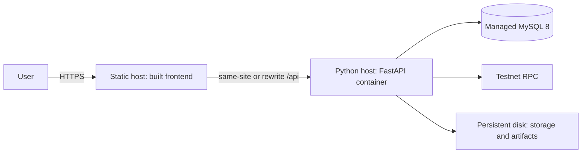

# Deployment

For the fastest local start, use Docker as described in the [README](../README.md). This guide covers running each service directly on Windows, then deploying to the cloud.

## Windows setup without Docker for the app

All commands are PowerShell, run from the repository root unless stated.

### 1-5. Install the tools

| Tool | Version used | Check |
|---|---|---|
| Python | 3.11 (3.14 was not tested with these packages) | `py -3.11 --version` |
| Node.js | 22 or newer (24 was used) | `node --version` |
| Git | Any recent version | `git --version` |
| Docker Desktop | Runs MySQL here. Or install MySQL 8 directly | `docker --version` |

### 6-7. Python environment and backend dependencies

Keep the environment outside OneDrive, or sync will churn through several gigabytes of PyTorch.

```powershell
py -3.11 -m venv $env:USERPROFILE\.venvs\proptwin
& $env:USERPROFILE\.venvs\proptwin\Scripts\Activate.ps1
pip install --extra-index-url https://download.pytorch.org/whl/cpu -r backend\requirements.txt
```

### 8. Frontend and contract dependencies

```powershell
npm install --prefix frontend
npm install --prefix blockchain
```

### 9. Environment variables

```powershell
Copy-Item .env.example .env
python -c "import secrets; print(secrets.token_urlsafe(48))"   # paste as SECRET_KEY
```

Set `MYSQL_PASSWORD` and `MYSQL_ROOT_PASSWORD`, use the same password in `DATABASE_URL`, and set `DEMO_PASSWORD`. Every variable is described in `.env.example`.

### 10. Create the database

```powershell
docker compose up -d mysql
```

MySQL listens on port 3307, so it will not clash with one already on 3306. With your own MySQL 8, create the database and user instead, and update `DATABASE_URL`.

### 11. Run migrations

```powershell
cd backend
alembic -c alembic.ini upgrade head
cd ..
```

### 12. Load sample data

```powershell
python database\seed\seed_demo.py
```

### 13. Train and activate the model

```powershell
python ml\scripts\train.py
cd backend
python -m app.cli list-models
python -m app.cli activate-model <version> --admin-email demo.admin@proptwin.example
cd ..
```

Activation is refused if the model did not beat the best baseline.

### 14. Deploy the contract locally

In a separate terminal, leave this running:

```powershell
npm run node --prefix blockchain
```

Then:

```powershell
npm run deploy:local --prefix blockchain
python scripts\configure_local_chain.py
```

### 15. Start the backend

```powershell
cd backend
uvicorn app.main:app --port 8000
```

### 16. Start the frontend

In another terminal:

```powershell
npm run dev --prefix frontend
```

### 17. Test the workflow

Open <http://localhost:5173>. Register, create a property, predict a valuation, create a twin, run a scenario, register it on the blockchain, and check its integrity. To automate this, see [Testing](TESTING.md).

## First administrator

Nobody can register as an administrator. Create the first one from a shell on the server:

```powershell
cd backend
python -m app.cli create-admin --email you@example.com
```

## Cloud deployment

This has **not been run**, because it needs accounts this project does not hold. Follow it as a plan and verify each step.



### The one decision to make first: same site

The refresh cookie is `SameSite=Strict`, so **the browser must see the frontend and the API as the same site**. Otherwise users are signed out on every reload. Choose one:

- Serve them from subdomains of a domain you own, such as `app.example.com` and `api.example.com`, or
- Have the static host rewrite `/api/*` to the backend, and leave `VITE_API_BASE_URL=/api/v1`.

Two unrelated platform domains, such as `something.vercel.app` and `something.onrender.com`, will **not** work without a rewrite.

### Frontend (any static host)

```powershell
npm ci --prefix frontend
$env:VITE_API_BASE_URL = "/api/v1"
npm run build --prefix frontend
```

Publish `frontend/dist`, with all routes falling back to `index.html`.

### Backend (any container host)

Build `backend/Dockerfile` from the repository root. The image applies migrations on startup. Attach persistent disks at `/app/storage` and `/app/ml/artifacts`. Run **one API process**, because rate limits and the job queue's model cache are per process. Point the health check at `/api/v1/health/live`.

Set these in the host's secret manager, never in a file:

| Variable | Value |
|---|---|
| `APP_ENV` | `production` |
| `SECRET_KEY` | At least 32 random characters |
| `DATABASE_URL` | Managed MySQL connection string, using TLS |
| `CORS_ORIGINS` | `["https://app.example.com"]` |
| `FRONTEND_BASE_URL` | `https://app.example.com` |
| `COOKIE_SECURE` | `true` |
| `SMTP_*` | Your mail provider, needed for password resets |
| `BLOCKCHAIN_*` | See the [blockchain guide](BLOCKCHAIN_GUIDE.md) |

Do **not** set `USE_HARDHAT_DEV_RELAYER` or `DEMO_PASSWORD`. In production the API refuses to start with placeholder secrets, insecure cookies, or a public Hardhat key, and the seed script refuses to run.

### Database (managed MySQL 8)

Enable automated backups and TLS, restrict access to the backend, and give the app a user limited to its own database. Set `time_zone` to UTC, although the app already stores UTC.

### HTTPS

Terminate TLS at the host or a proxy, and redirect HTTP to HTTPS.

### Smoke test after deploying

```powershell
$api = "https://api.example.com/api/v1"
Invoke-RestMethod "$api/health/ready"        # database ok; check model_available and blockchain_reachable
Invoke-RestMethod "$api/blockchain/network"  # reachable: true, and the expected contract
```

Then, in a browser, run the workflow in step 17, and **reload the page while signed in** to prove that the cookie works.

### Before real use

- Replace the synthetic model with one trained on licensed data.
- Have the contract audited if it will hold anything of value.
- Review document retention against local privacy law.
