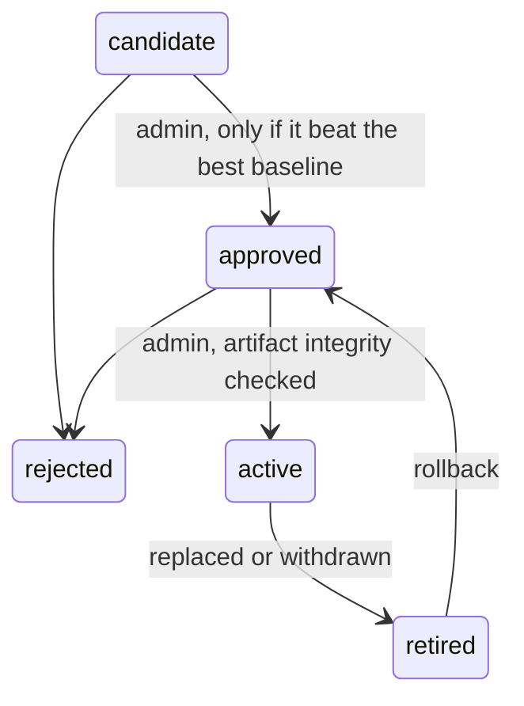

# ML pipeline

## Data

The default dataset, `ml/data/synthetic_transactions.csv`, is **fictional** and made by `ml/scripts/generate_dataset.py` (seed 42).

| | |
|---|---|
| Source | Generated by this repository. No real data was used |
| License | Same as this repository |
| Size | 15,150 rows, of which 14,809 survive cleaning |
| Period | Sales dated January 2016 to June 2026 |
| Units | Prices in INR, areas in square feet |
| Geography | 12 fictional localities in 3 fictional cities |

Prices follow a known formula with 11% log-normal noise, so about 9% average error is the practical limit on this data. A small share of rows is deliberately corrupted, so that cleaning handles real faults: duplicates, missing values, negative and implausibly low prices, and zero areas.

### Columns

`transaction_date`, `sale_price` (target), `property_type`, `locality`, `city`, `state`, `latitude`, `longitude`, `built_up_area_sqft`, `land_area_sqft`, `bedrooms`, `bathrooms`, `construction_year`, `floor_number`, `total_floors`, `condition`, `parking_spaces`, `amenities` (`|`-separated), `market_index`, `is_synthetic`.

### Features deliberately excluded

- **Monthly rent:** often missing or derived from price, and it is an output that the twin reports.
- **Last sale price:** unavailable for many properties. It is shown as a comparison only.

## Stages

| # | Stage | Where |
|---|---|---|
| 1-6 | Load, validate schema, remove duplicates, handle missing and invalid values | `ml/preprocessing/pipeline.py` |
| 7-8 | Encode, scale, convert to tensors. Fitted on training rows only | `ml/preprocessing/pipeline.py` |
| 9-10 | Temporal split (70/15/15), so the model trains on the past and is tested on the future | `ml/preprocessing/pipeline.py` |
| 11 | Baselines: median price per sq ft by locality, and Ridge regression | `ml/models/trainer.py` |
| 12 | PyTorch MLP on log price, with early stopping on validation data | `ml/models/trainer.py` |
| 13 | Compare all three on the same held-out rows | `ml/scripts/train.py` |
| 14 | Save an immutable artifact with SHA-256 digests | `ml/scripts/train.py` |
| 15-16 | Verify digests, load, and serve through the API | `backend/app/ml/inference.py` |

`backend/app/ml/features.py` is shared by training and serving, so that the two cannot drift apart.

## Train

```powershell
python ml/scripts/generate_dataset.py     # optional: the CSV is already in the repository
python ml/scripts/train.py                # add --data path\to.csv --real for your own data
```

## Recorded results

Measured on 2,222 held-out sales from 2024-11-24 to 2026-06-29, on Windows. **Synthetic data only.** Retraining with the same seed on the same machine reproduced these figures exactly. In the Linux container the results differ slightly (the interval radius was 0.2080 against 0.2078, and coverage 89.3% against 89.4%), so treat reproducibility as per-platform.

| Model | MAE (INR) | RMSE (INR) | R² | MAPE |
|---|---|---|---|---|
| Locality median baseline | 74,71,553 | 1,26,68,851 | 0.585 | 30.2% |
| Ridge baseline | 31,41,203 | 62,92,441 | 0.898 | 14.8% |
| **PyTorch MLP** | **20,75,138** | **36,79,154** | **0.965** | **10.0%** |

The 90% prediction interval covered 89.4% of held-out rows, slightly under target.

## Uncertainty

The range is a split conformal interval built from validation residuals on log price. Its coverage holds when future data resembles the validation data, which is not guaranteed in a shifting market. That is why the measured test coverage is stored with each model.

## Valuation factors

For each group of inputs, the API re-predicts with that group moved to its training median or mode, and reports the change. This describes **the model's sensitivity, not market causes**. Inputs that were not provided are left out, because their "effect" would only measure the model's reaction to a blank. They are listed as a limitation instead.

## Estimates the API refuses or qualifies

| Situation | Behaviour |
|---|---|
| No active model | `503 model_unavailable`, with no figure |
| No built-up area | `422 insufficient_features` |
| Extrapolates to an unrepresentable value | `422 estimate_out_of_range` |
| Area outside the training range, unknown locality, or market index out of range | Estimate returned with an explicit limitation |

The current market index will sit above the training range as time passes. The model then extrapolates and says so. Retrain to fix this.

## Promotion

Training only creates a **candidate**. Nothing reaches users without an administrator.



Use the Administration page, or `python -m app.cli activate-model <version> --admin-email <admin>`. Both run the same checks.

## Using real data

1. Obtain a dataset you are licensed to use, and record its source, license, units and period here.
2. Map it to the columns above. Provide a `market_index` that is **not** computed from the same sales, or it will leak the target.
3. Train with `--real`, so that the model is not labelled synthetic.
4. Review its metrics, and how it does on each city and property type, before approving it.
5. Replace the synthetic rows in `market_observations`, or the API will keep using them.
